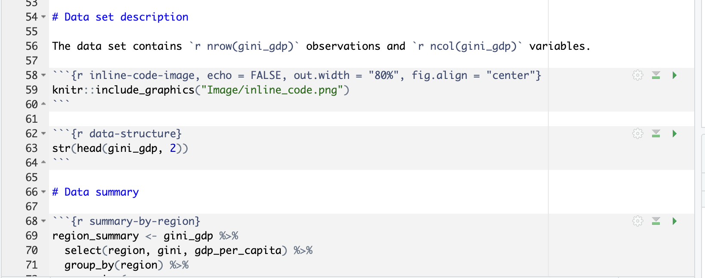

# Loading libraries

```{r load-libraries, include = TRUE}
library(dplyr)
library(readr)
library(ggplot2)
library(knitr)

knitr::opts_chunk$set(echo = TRUE, message = FALSE, warning = FALSE)
```

# Research question

Do countries with a higher GDP per capita have lower income inequality? We also ask whether this relationship looks the same across world regions.

# Data set introduction

The data come from the [Income inequality vs. GDP per capita](https://ourworldindata.org/grapher/gini-coefficient-vs-gdp-per-capita-pip) chart published by Our World in Data, which combines World Bank poverty and inequality estimates with GDP per capita figures. For each country, I kept the most recent year between 2015 and 2024 in which both inequality and GDP per capita were available.

The variables `country` and `region` record each country's name and its world region. The variable `year` is the year of the latest inequality survey, and `gini` is the Gini coefficient, which ranges from 0 (everyone has the same income) to 1 (one person has all the income). The variable `gdp_per_capita` is GDP per person, adjusted for inflation and for differences in living costs between countries (international-$).

```{r read-data}
gini_gdp <- read_csv("Data/gini_gdp.csv")
```

```{r variable-table}
variable_info <- tibble(
  Variable = names(gini_gdp),
  Description = c(
    "Country name",
    "World region (Our World in Data definition)",
    "Year of the most recent inequality survey",
    "Gini coefficient of income or consumption (0 to 1)",
    "GDP per capita (international-$, adjusted for inflation)"
  )
)

kable(variable_info, caption = "Variables in the data set")
```

# Data set description

The data set contains `r nrow(gini_gdp)` observations and `r ncol(gini_gdp)` variables.

```{r inline-code-image, echo = TRUE, out.width = "80%", fig.align = "center"}

```

```{r data-structure}
str(head(gini_gdp, 2))
```

# Data summary

```{r summary-by-region}
region_summary <- gini_gdp %>%
  select(region, gini, gdp_per_capita) %>%
  group_by(region) %>%
  summarise(
    mean_gini = mean(gini),
    sd_gini = sd(gini),
    mean_gdp = mean(gdp_per_capita),
    sd_gdp = sd(gdp_per_capita)
  ) %>%
  arrange(desc(mean_gdp))

kable(
  head(region_summary, 10),
  digits = c(0, 3, 3, 0, 0),
  format.args = list(big.mark = ","),
  col.names = c("Region", "Mean Gini", "SD Gini",
                "Mean GDP per capita", "SD GDP per capita"),
  caption = paste("Mean and standard deviation of the Gini coefficient",
                  "and GDP per capita by world region")
)
```

Europe is by far the richest region on average and, together with Oceania, has the **lowest** average Gini coefficient (about 0.31). South America is the most unequal region (mean Gini of about 0.44) even though its average income is lower than Asia's, while Africa is the poorest region but not the most unequal.

# Visualisations

```{r gini-gdp-scatter, fig.cap = "Gini coefficient against GDP per capita (log scale) for each country, coloured by world region.", fig.width = 8, fig.height = 5}
ggplot(gini_gdp, aes(x = gdp_per_capita, y = gini, colour = region)) +
  geom_point(size = 2, alpha = 0.8) +
  scale_x_log10(labels = scales::label_comma()) +
  labs(
    x = "GDP per capita (international-$, log scale)",
    y = "Gini coefficient",
    colour = "Region"
  ) +
  theme_minimal()
```

- *Richer countries tend to have slightly lower inequality, but the points are widely spread and the correlation between log GDP per capita and the Gini coefficient is only `r round(cor(log(gini_gdp$gdp_per_capita), gini_gdp$gini), 2)`.*
- *Countries group by region more than by income: European countries sit at the bottom of the chart, while South and North American countries sit higher at similar income levels.*

# Conclusions

The data give only weak support to the idea that richer countries are more equal. Across all countries, higher GDP per capita goes together with a slightly lower Gini coefficient, but the relationship is weak and many countries do not follow it. The world region seems to matter more: Europe is both rich and equal, the Americas are unequal at many income levels, and Africa and Asia show a wide spread. These results show an association, not a cause. Differences in tax and welfare systems, history and how inequality is measured (income in some countries, consumption in others) could explain the pattern. The survey years also differ between countries, so the comparison is not perfectly like for like.
